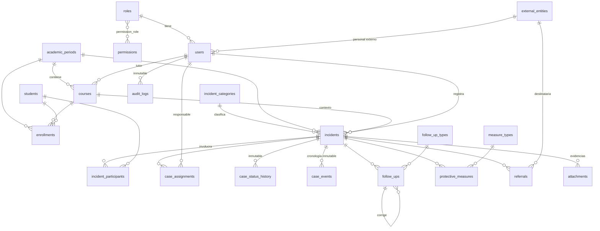
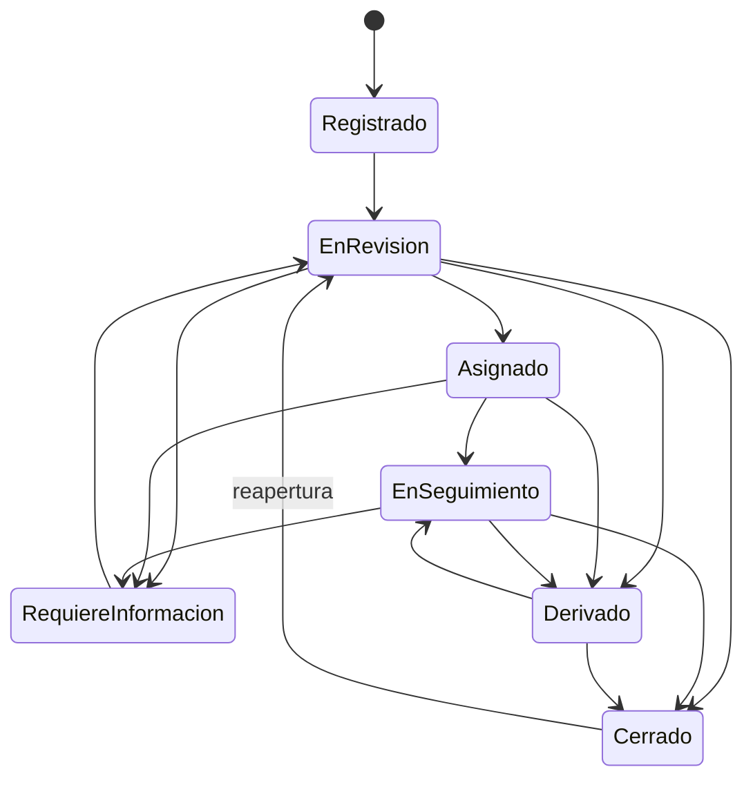

# Fase 0 — Análisis, arquitectura y modelo de datos

**Proyecto:** TIC PARA UNIDADES EDUCATIVAS SEGURAS: MONITOREO, COMUNICACIÓN Y CULTURA DE PREVENCIÓN
**Institución:** Unidad Educativa Cardenal Richard Cushing (Ecuador)
**Fecha de la fase:** 22 de octubre de 2026

## 1. Diagnóstico inicial

No existía un proyecto previo. Se creó desde el esqueleto oficial de Laravel 12 (v12.12.2) con Laravel Framework 12.70.1, PHP 8.3.6 y PostgreSQL 16.15. Las versiones mínimas para instalar en otro equipo son PHP 8.2 con las extensiones `pdo_pgsql`, `pgsql`, `mbstring`, `xml`, `zip`, `gd` e `intl`, PostgreSQL 14 o superior y Composer 2.

Dependencias añadidas al esqueleto y su motivo:

| Paquete | Uso | Sprint |
|---|---|---|
| `barryvdh/laravel-dompdf` ^3.1 | Reportes PDF | 6 |
| `openspout/openspout` ^4.28 | Reportes Excel (.xlsx) sin dependencias pesadas | 6 |
| `bacon/bacon-qr-code` ^3.0 | Generación del QR en PNG y SVG | 3 |
| `phpunit/phpunit` ^11.5 | Pruebas automatizadas | todos |

Se retiraron del esqueleto `laravel/pail`, `laravel/pint`, `laravel/sail` y `nunomaduro/collision` porque no aportan a este proyecto. Por eso las pruebas se ejecutan con `php vendor/bin/phpunit` (equivalente a `composer test`).

## 2. Arquitectura

Arquitectura en tres capas sobre el patrón MVC de Laravel:

```
┌──────────────────────── Presentación ────────────────────────┐
│ Blade + Bootstrap 5 + JS  ·  Rutas públicas │ Rutas privadas │
│ (bienvenida, QR, reporte público)           │ (auth + rol)   │
└──────────────────────────────┬────────────────────────────────┘
┌──────────────────────── Lógica de negocio ───────────────────┐
│ Controladores delgados → Form Requests (validación)          │
│ Policies/Gates (autorización por rol y por caso)             │
│ Servicios: IncidentRegistrar, CaseWorkflow, AuditLogger,     │
│            AttachmentStorage, ReportExporter, QrGenerator    │
│ Enums: CaseStatus (transiciones), roles, catálogos fijos     │
└──────────────────────────────┬────────────────────────────────┘
┌──────────────────────── Acceso a datos ──────────────────────┐
│ Eloquent (consultas parametrizadas) → PostgreSQL 16          │
│ CHECK, FK restrict, índices parciales, secuencia de códigos, │
│ triggers de inmutabilidad · Disco privado para evidencias    │
└───────────────────────────────────────────────────────────────┘
```

Principios aplicados: autorización siempre en el servidor (la interfaz solo oculta opciones), controladores sin reglas de negocio, transacciones en toda operación que toque varias tablas, y defensa en profundidad: las reglas críticas se validan en el servicio **y** en la base de datos.

## 3. Modelo de datos



### Tablas (25 en total)

| Grupo | Tablas |
|---|---|
| Acceso | `users`, `roles`, `permissions`, `permission_role`, `sessions`, `password_reset_tokens` |
| Catálogos académicos | `academic_periods`, `courses`, `students`, `enrollments` |
| Catálogos de casos | `incident_categories`, `measure_types`, `follow_up_types`, `external_entities` |
| Casos | `incidents`, `incident_participants`, `case_assignments`, `case_status_history`, `case_events` |
| Actuaciones | `follow_ups`, `protective_measures`, `referrals`, `attachments` |
| Transversales | `audit_logs`, `notifications` (+ `cache`, `jobs` de Laravel) |

### Reglas garantizadas por PostgreSQL

| Regla | Mecanismo |
|---|---|
| Código de caso único y sin colisiones concurrentes | `UNIQUE(code)` + secuencia `incident_code_seq` → `UECRC-2026-000001` |
| Solo estados, prioridades, roles y canales válidos | Restricciones `CHECK` sincronizadas con los enums (verificado por prueba) |
| Reporte interno siempre con usuario registrador | `CHECK (source = 'publico' OR reporter_user_id IS NOT NULL)` |
| Caso cerrado siempre con fecha de cierre | `CHECK (status <> 'cerrado' OR closed_at IS NOT NULL)` |
| Un solo periodo lectivo vigente | Índice único parcial `WHERE is_current = true` |
| Sin doble asignación activa de la misma persona | Índice único parcial `WHERE unassigned_at IS NULL` |
| Corrección de seguimiento siempre con motivo | `CHECK` sobre `correction_reason` |
| Historial, cronología y bitácora inmutables | Trigger `prevent_modification()` en UPDATE, DELETE y TRUNCATE |
| Casos no eliminables; seguimientos no editables | Triggers en `incidents` y `follow_ups` |
| Catálogos con historial no eliminables | Claves foráneas `RESTRICT` |
| Correo de usuario único sin distinguir mayúsculas | Índice único sobre `LOWER(email)` |

## 4. Estados y transiciones del caso



Exigen justificación escrita: pasar a *Requiere información*, *Derivado* o *Cerrado*, y reabrir un caso cerrado. Asignar o derivar nunca cierra el caso. Los estados no son un catálogo editable porque dependen de estas reglas; las categorías, tipos de medida y tipos de actuación sí lo son.

## 5. Roles y permisos (mínimo privilegio)

| Permiso | Admin. técnico | Docente | DECE | Autoridad | Policía |
|---|:-:|:-:|:-:|:-:|:-:|
| Gestionar usuarios, catálogos, configuración y QR | ✔ | | | | |
| Consultar bitácora | ✔ | | | ✔ | |
| Registrar incidentes y ver los propios | | ✔ | ✔ | ✔ | |
| Adjuntar evidencias, buscar estudiantes | | ✔ | ✔ | | |
| Bandeja, expediente completo, estados, asignación | | | ✔ | | |
| Registrar seguimientos | | solo si está asignado | ✔ | | |
| Medidas y derivaciones | | | ✔ | | |
| Casos derivados a su entidad (resumen compartido) | | | | | ✔ |
| Dashboard agregado y reportes PDF/Excel | | | ✔ | ✔ | |
| Exportar información identificable | | | ✔ | | |

El administrador técnico no accede a expedientes. La autoridad ve indicadores agregados; el acceso a un caso concreto queda para cuando la institución lo apruebe. La policía solo ve las derivaciones dirigidas a la entidad vinculada a su cuenta (`users.external_entity_id`) y el campo `referrals.shared_summary`, nunca la descripción completa ni el resto de la base.

## 6. Módulos y dependencias

| Sprint | Módulo | Depende de |
|---|---|---|
| 0 ✔ | Proyecto, configuración, modelo de datos, seeders, comando de administrador | — |
| 1 | Autenticación, bloqueo por intentos, usuarios, roles, Policies, bitácora (`AuditLogger`), layout | 0 |
| 2 | Catálogos: periodos, cursos, estudiantes, categorías, entidades, tipos de medida y actuación | 1 |
| 3 | Página pública, QR, formulario público con anti-spam, registro interno, adjuntos privados | 1, 2 |
| 4 | Bandeja DECE, detalle, asignaciones, transiciones de estado, historial, notificaciones de nuevo caso | 3 |
| 5 | Seguimientos y correcciones, medidas, derivaciones, vista policial | 4 |
| 6 | Dashboard, reportes PDF/Excel, consulta de bitácora, resto de notificaciones | 4, 5 |
| 7 | Pruebas integrales, manuales, despliegue HTTPS, QR definitivo | todos |

La bitácora se adelanta al Sprint 1 porque el inicio de sesión ya es una operación crítica que debe auditarse.

## 7. Decisiones tomadas (con valores predeterminados razonables)

1. **Un rol por usuario.** Simplifica las Policies y evita combinaciones de privilegios no previstas. Si alguien cumple dos funciones, se discute antes de habilitar varios roles.
2. **Datos mínimos del estudiante:** código institucional y nombres. Sin cédula, dirección, teléfono ni datos de salud.
3. **Involucrados no estudiantes:** se describen de forma genérica (`non_student_description`), sin datos identificativos innecesarios.
4. **El rol "señalado"** reemplaza términos como "agresor": el sistema no determina responsabilidades.
5. **Reportes públicos habilitados por configuración** (`REPORTES_PUBLICOS_HABILITADOS`). El contacto de quien reporta es opcional y el formulario no promete anonimato, porque la IP pasa por el limitador de envíos y por el servidor web.
6. **Correcciones trazables:** un seguimiento nunca se edita; se registra uno nuevo con `corrects_follow_up_id` y motivo.
7. **Contraseñas:** bcrypt mediante el cast `hashed`. El administrador inicial se crea con `php artisan tic:crear-admin`, que pide la contraseña de forma oculta y exige 12 caracteres con mayúsculas, minúsculas, números y símbolos.
8. **Datos DEMO** solo en `APP_ENV=local`, con correos `.test`, estudiantes `DEMO-0001…` con nombres genéricos y contraseña tomada de `DEMO_PASSWORD` o generada al azar. El seeder rechaza ejecutarse en producción.
9. **Zona horaria `America/Guayaquil` e idioma `es`** por defecto.
10. **Sesiones** cifradas, de 60 minutos, que expiran al cerrar el navegador.

## 8. Protección de datos (LOPDP) — puntos que requieren decisión institucional

El sistema se diseña para facilitar el cumplimiento de la Ley Orgánica de Protección de Datos Personales, pero **esta fase no constituye una evaluación de cumplimiento**. Antes de usar datos reales, la institución debe definir o aprobar lo siguiente: la base legal del tratamiento y el responsable designado; el texto definitivo del aviso de privacidad del formulario; si se habilitan los reportes públicos y en qué condiciones; si se registra la IP en la bitácora y por cuánto tiempo (`AUDITORIA_REGISTRAR_IP`); los plazos de conservación de casos cerrados y de evidencias; el procedimiento formal de derivación y qué información se comparte con cada entidad; quién puede exportar información identificable; y la evaluación de impacto, dado que se tratan datos de niñas, niños y adolescentes.

## 9. Inventario de la Fase 0

| Archivo | Contenido |
|---|---|
| `.env.example` | Variables documentadas, sin secretos |
| `config/seguridad_escolar.php` | Institución, QR, reportes públicos, adjuntos, login, auditoría |
| `config/app.php` | Zona horaria y locale configurables (por defecto Ecuador / español) |
| `phpunit.xml` | Pruebas sobre PostgreSQL (`tic_ues_test`) |
| `database/migrations/2026_10_22_000100…001200` | 12 migraciones del modelo |
| `app/Enums/*` | 14 enums con etiquetas en español y transiciones |
| `app/Models/*` | 21 modelos Eloquent con relaciones; `Concerns/Immutable` |
| `app/Console/Commands/CreateAdminCommand.php` | `tic:crear-admin` |
| `database/seeders/*` | Roles y permisos, catálogos, datos DEMO |
| `database/factories/*` | Usuarios y estudiantes ficticios |
| `tests/Unit/CaseStatusTest.php` | 6 pruebas de reglas de transición |
| `tests/Feature/Fase0/*` | 24 pruebas de esquema, integridad, inmutabilidad, permisos y comando |

## 10. Resultado verificado de pruebas

Ejecutado el 22/10/2026 sobre PHP 8.3.6 y PostgreSQL 16.15:

```
PHPUnit 11.5.57
..............................   30 / 30 (100%)
OK (30 tests, 169 assertions)
```

También se verificó `migrate:fresh --seed`, `migrate:rollback` completo y una nueva migración sin errores.

## 11. Pendiente para el Sprint 1

Archivos de idioma `lang/es` (validación y autenticación), layout Blade con Bootstrap 5 y menú lateral, inicio y cierre de sesión con bloqueo por intentos, recuperación de contraseña (en modo `log` hasta configurar correo), cambio obligatorio de contraseña, middleware de cuenta activa, Gates a partir de la matriz de permisos, `AuditLogger`, CRUD de usuarios con activación y desactivación, y sus pruebas de autorización.
